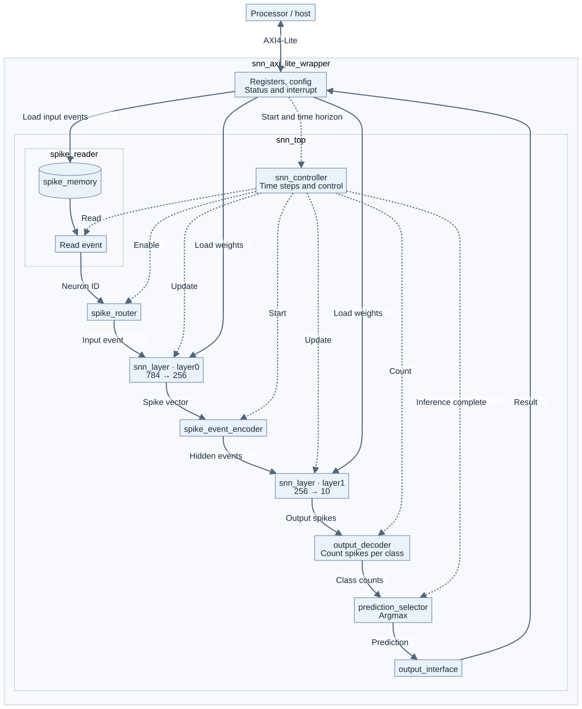

# Understanding and modifying the architecture

The system is an event-driven, fully connected SNN with exactly two trainable
layers. The references use 784 inputs, 256 hidden neurons and 10 output neurons.
The host converts each image into timestamped spikes; the FPGA receives events
and INT8 weights.



## Data flow

1. `snn_axi_lite_wrapper.sv` accepts control commands, weights and events.
2. `spike_memory.sv` and `spike_reader.sv` store and supply events.
3. `snn_controller.sv` controls time steps and the two layers.
4. Within `snn_layer.sv`, `synapse_bram.sv` supplies weights and
   `synapse_accumulator.sv` accumulates synaptic currents. Neurons are then
   updated. See [inside snn_layer](images/02_snn_layer.svg).
5. `neuron_array.sv` maps neurons to the supported executor configuration:
   one shared executor for each reference layer, with an additional fully
   parallel option for LIF. `neuron_core.sv` defines a common neuron handshake;
   the shared-executor branches instantiate the model-specific neurons directly.
6. Hidden spikes reach the output layer through the encoder. Class counters
   and `prediction_selector.sv` determine the result.

Stages apply backpressure. A `start` completes with `done`; latency depends
on the neuron model. A soft-clear operation resets inference state without
replacing the loaded weights.

## When are parameters fixed?

| At FPGA build time | At model upload / inference time |
|---|---|
| Dimensions of both layers | INT8 weights |
| Neuron model per layer | Host-side image pixel encoding |
| Executor count per layer | Event count and timestamps |
| Event memory capacity | Inference horizon T |
| Numeric widths and neuron parameters | Image/sample index for stochastic encoding |
| Interface version and clock | Weight/event CRC and start command |

The exact configuration is in [references.json](../configs/references.json).
The three references use model IDs 0/0 (LIF), 1/1 (IZH) and 2/2 (HH), one
executor per layer, interface 1.6, 100 MHz and 12,544 event slots. T = 8.
Changing network dimensions requires matching weights and a new build;
a host parameter cannot change a synthesized dimension.

## Number formats and model contract

Weights are signed INT8, stored as `weights[pre][post]`. The reference topology
requires 200,704 bytes for layer 0 and 2,560 for layer 1. Membrane and current
values use 24 bits, class counters 16 bits and timestamps 32 bits. Rounding,
wrap-around, reset and model constants form part of the architecture.
The host checks them against readable registers before upload.

- [Numerical specification](numerical_specification.md): exact arithmetic
  rules and handshake contracts for extensions.
- [Register and upload protocol](ps_pl_interface.md): offsets, status, CRC,
  upload order and telemetry. Offsets refer to the XRT kernel.
- `python/snn_reference/`: executable, bit-accurate counterpart to the RTL.

HH requires six ROM tables in `data/hh_luts/`. They are part of the source
and can be reproduced with `snn_verification.generate_hh_luts`. The Float64
HH reference supports numerical understanding; FPGA equivalence is checked
against the fixed-point reference.

## Validating changes

```bash
python tools/run_checks.py
```

This runs lint, 18 directed RTL tests, 12 LIF RTL/reference cases, Python core
checks and the three selected model packages with synthetic inputs. The RTL
tests use small networks; they do not fully simulate the three trained MNIST
models. CUDA/training checks are separate:

```bash
python tools/run_checks.py --suite python --training
```

When changing number formats, update the reference model, export, host checks
and RTL together. For new registers, also synchronize `registers.py`, the
wrapper and protocol documentation. A different FPGA platform requires
adaptation and revalidation of the kernel connection, platform and constraints;
the build described here specifically targets the U50.
